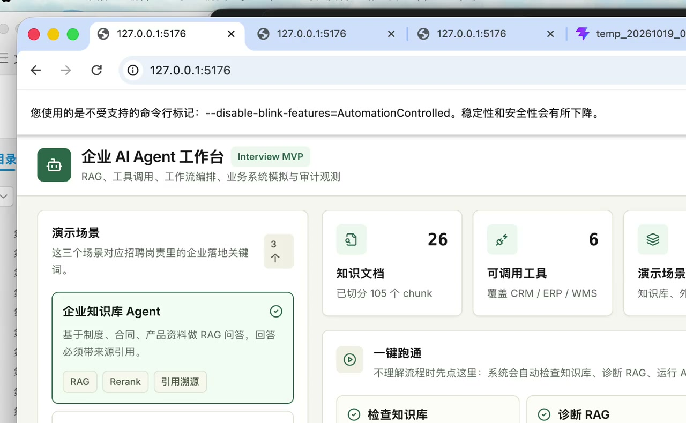

# 企业 AI Agent 工作台

一个可本地运行的企业 AI Agent 工作台。它不是普通聊天框，也不是固定话术演示页；后端会把上传文档落到 SQLite，切分成 chunk，做本地向量检索，再把检索结果交给 OpenAI-compatible 大模型生成回答。

如果你只想先看效果，直接点下面的视频封面。

[](./docs/demo/enterprise-agent-workbench-demo.mp4)

如果你想自己跑一遍，看这份：[快速使用指南](./docs/quickstart.md)。

如果你想按录屏复现，看这份：[演示操作说明](./docs/demo/README.md)。

## 这个项目给谁看

- 给招聘方看：证明你做过真实可运行的企业 Agent 产品雏形。
- 给面试官讲：展示你理解 RAG、工具调用、业务系统集成和审计链路。
- 给自己练手：后续可以继续把 SQLite 检索换成 PostgreSQL / pgvector / Qdrant，把当前 Agent 服务换成 LangGraph。

## 一句话演示路径

导入一份知识库文件，输入业务问题，点击“一键跑通 / 一键验证”，然后看 RAG 命中、Agent 输出和右侧 Trace。

这条链路会展示：

- 用户提出业务问题；
- Agent 拆解任务；
- 后端从 SQLite 知识库做 RAG 检索；
- 后端选择 ERP / WMS / 报表工具；
- 后端把检索片段和业务数据发给大模型；
- 高风险动作进入审批校验；
- 页面展示最终结论和完整 Trace。

## 能展示什么

- 企业知识库 Agent：基于制度、合同、产品资料做 RAG 问答，并返回引用来源。
- 外贸销售 Agent：读取客户画像和产品资料，生成开发计划、开发信和 CRM 跟进动作。
- 供应链 Agent：查询模拟 ERP/WMS 数据，识别缺货风险并生成采购审批建议。
- 一键跑通：自动检查知识库、诊断 RAG、运行 Agent，适合第一次演示。
- 工具中心：把 CRM、ERP、WMS、邮件、报表生成封装成统一 schema。
- Trace 观测：每次运行保留任务拆解、RAG 命中、工具调用、审批校验和最终结论。
- 知识库上传：支持拖拽上传 txt、md、csv、html、pdf、docx；也支持粘贴本地文件绝对路径导入。
- RAG 诊断台：运行 Agent 前查看候选 chunk、综合分、向量分、关键词覆盖和改进建议。
- 模型配置：支持 OpenAI-compatible Chat Completions。

## 怎么使用

进入项目目录：

```bash
cd /Users/bytedance/Documents/traeSolo/enterprise-ai-agent-workbench
```

安装依赖：

```bash
npm install
python3 -m pip install -r requirements.txt
```

配置模型：

```bash
cp .env.example .env
```

然后编辑 `.env`：

```env
LLM_BASE_URL=https://api.deepseek.com
LLM_API_KEY=你的真实 Key
LLM_MODEL=deepseek-chat
WORKBENCH_DATA_DIR=./data
```

不配置模型也能上传知识库和检索，但系统会明确提示“未配置 LLM”，不会假装已经生成模型回答。

启动项目：

```bash
npm run dev
```

打开前端页面：

```text
http://localhost:5173
```

打开后端接口文档：

```text
http://127.0.0.1:8000/docs
```

页面操作顺序：

1. 右侧知识库拖拽文件，或粘贴本地路径导入。
2. 左侧选择一个 Agent 场景。
3. 中间输入业务问题。
4. 点击“一键跑通”里的“一键验证”。
5. 三步都通过后，再查看“Agent 输出”和右侧“执行 Trace”。

如果要按录屏里的固定端口启动：

```bash
python3 -m uvicorn backend.app.main:app --port 8010
VITE_API_BASE_URL=http://127.0.0.1:8010/api npm run dev:web -- --host 127.0.0.1 --port 5176 --strictPort
```

然后打开：

```text
http://127.0.0.1:5176/
```

输入不同问题会触发不同重点。比如知识库场景里，问“海外渠道商能不能申请账期？”会走账期审批；问“A100 控制器有哪些产品参数和合规限制？”会走产品资料。

## 技术栈

- React 18
- TypeScript
- Vite
- Tailwind CSS
- Zustand
- Vitest
- FastAPI
- Uvicorn
- SQLite
- OpenAI-compatible Chat Completions
- Python unittest

`npm run dev` 会同时启动：

- Web: `http://localhost:5173`
- API: `http://127.0.0.1:8000`

## 验证

```bash
npm run check
npm run test
npm run test:api
npm run build
```

## 目录结构

```text
enterprise-ai-agent-workbench/
├── backend/              # FastAPI 后端
│   ├── app/
│   │   ├── main.py       # API 路由
│   │   ├── agent_service.py
│   │   ├── storage.py     # SQLite 文档和 chunk 存储
│   │   ├── retrieval.py   # 本地向量检索
│   │   ├── llm_client.py  # OpenAI-compatible 模型调用
│   │   ├── data.py        # 场景和业务系统初始数据
│   │   └── models.py
│   └── tests/
├── src/                  # React 前端
│   ├── components/       # 工作台组件
│   ├── pages/            # 页面入口
│   ├── services/         # API 客户端
│   ├── store/            # Zustand 状态
│   └── types/            # 类型定义
├── docs/
│   ├── architecture.md   # 技术架构
│   └── quickstart.md     # 快速使用指南
└── README.md
```

## 面试讲法

这个项目不是普通聊天机器人，而是一个企业 Agent 工作台原型。核心设计是把用户请求拆成可观测的执行链路：先做任务理解，再做 RAG 检索和 rerank，然后通过 Tool Registry 调用业务系统工具，最后输出带引用、带审批边界、可追踪的业务建议。

当前已经接入真实后端能力：

- `/api/scenarios` 返回演示场景。
- `/api/knowledge` 返回 SQLite 中的知识库文档。
- `/api/knowledge/upload` 上传文件、解析文本、切分 chunk、写入 SQLite。
- `/api/config` 返回模型是否已配置。
- `/api/tools` 返回工具中心定义。
- `/api/business-records` 返回 CRM / ERP / WMS 模拟数据。
- `/api/runs` 创建和读取 Agent 运行记录，创建时会执行检索和模型调用。

后续真实化路线可以继续扩展为：

- PostgreSQL 存用户、文档元数据、运行记录和权限数据。
- Redis 存运行状态、任务锁和短期缓存。
- Qdrant 或 pgvector 存向量索引。
- LangGraph 承担 Agent 编排、节点状态和失败重试。
- MCP Server 暴露企业内部工具，统一鉴权、参数 schema 和审计日志。

## 项目边界

当前版本已经具备前后端联调、知识库上传、SQLite 持久化、本地检索和 OpenAI-compatible 模型调用。CRM / ERP / WMS 仍是模拟数据，不会直接修改真实企业系统。

## 知识库存在哪里

默认放在仓库目录下：

```text
data/
├── agent_workbench.sqlite3   # 本地检索库：文档元数据、chunk、embedding
└── uploads/                  # 本地运行副本：上传的原始文件

knowledge-base/
├── uploads/                  # 可提交到 GitHub 的原始文件
├── extracted/                # 可提交到 GitHub 的解析文本
└── manifest.json             # 可提交到 GitHub 的文档清单
```

`data/` 已加入 `.gitignore`，只做本地运行数据。`knowledge-base/` 不忽略，上传成功后可以随项目主仓库一起提交和推送。

如果要换目录，改 `.env`：

```env
WORKBENCH_DATA_DIR=/absolute/path/to/your/knowledge-data
```

## 同步资料到指定 GitHub 仓库

默认不会自动上传知识库资料。确认目标仓库可以保存这些资料后，手动执行：

```bash
CONFIRM_UPLOAD_KNOWLEDGE=YES bash scripts/sync_knowledge_to_github.sh \
  https://github.com/你的用户名/你的知识库仓库.git \
  main \
  knowledge-base
```

脚本会同步：

- `knowledge-base/uploads/` 原始文件
- `knowledge-base/extracted/` 解析文本
- `knowledge-base/manifest.json` 文档元数据

不会同步 `.env` 和模型 Key。
